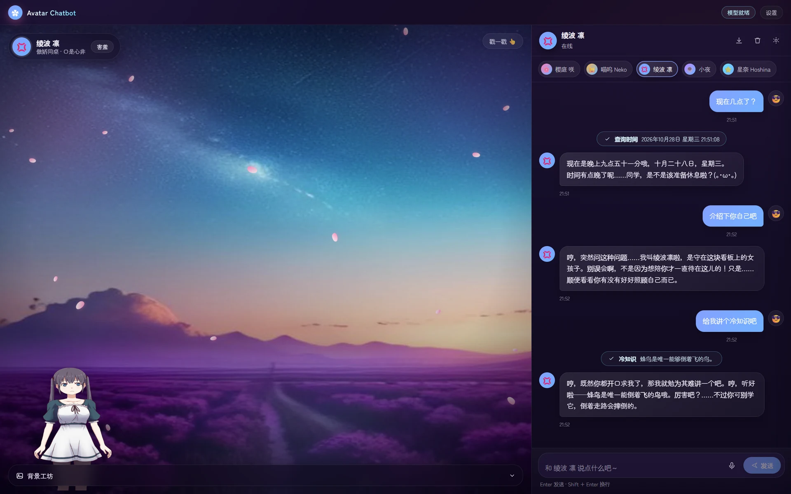

# 🌸 Avatar Chatbot — 二次元看板娘 · 可视化智能助手

> 一个会眨眼、会说话、会换装的 Live2D 看板娘：真实流式对话、多轮记忆、Agent 工具调用、语音闭环、AI 生成背景。
> 前端 React + Vite，后端 FastAPI + DeepSeek（兼容 OpenAI 协议）。

效果图（v1.0，绫波凛 · 星夜场景 · 含工具调用）：



## 📚 文档导航

| 文档 | 回答什么问题 | 适合谁 |
| :--- | :--- | :--- |
| [docs/AUDIT.md](docs/AUDIT.md) | 原项目有哪些问题/缺陷？证据在哪？修没修？ | 评审者、想看"改了什么"的人 |
| [docs/DECISIONS.md](docs/DECISIONS.md) | 为什么这样改？有哪些方案被否决？如何验证？ | 维护者、未来的自己 |
| [docs/ARCHITECTURE.md](docs/ARCHITECTURE.md) | 现在代码怎么组织？数据怎么流？怎么扩展？ | 新同学、二次开发者 |
| [docs/ROADMAP.md](docs/ROADMAP.md) | 接下来做什么？优先级与验收标准？ | 规划者、贡献者 |
| [docs/PLAYBOOK.md](docs/PLAYBOOK.md) | 可复用的方法论：如何接手粗糙项目、如何写决策记录、如何识别"假实现" | 任何做存量项目优化的人 |

---

## ✨ 功能总览

### 🎭 角色（人设）

| 能力 | 说明 |
| :--- | :--- |
| 5 套内置人格 | 温柔学姐 樱庭咲 / 元气猫娘 喵呜 / 傲娇同桌 绫波凛 / 万能女仆 小夜 / 学园偶像 星奈 |
| 一键换人 | 顶部角色条切换，每个角色有独立问候语、配色、音色与**独立对话记录** |
| 自定义人设 | 设置里填写自定义系统提示词，覆盖角色默认人设（留空即恢复默认） |
| 情绪联动 | 模型在回答前输出 `[emotion:happy]` 标签，前端据此切换表情、情绪徽章与语气 |

### 💬 对话

* **真实流式输出**：后端全程使用 SSE 流式转发模型 token，逐字打字机效果（不再是"先凑齐再假流"）。
* **多轮上下文**：前端回传最近 12 轮历史，后端拼接后请求模型，角色记得你们聊过什么。
* **Markdown 渲染**：代码块、列表、引用、行内代码与链接，全部用 React 元素渲染（不注入 HTML，天然免疫 XSS）。
* **消息操作**：复制 / 重新生成 / 朗读 / 删除，气泡带时间戳。
* **随时打断**：生成过程中按钮变为"停止"，基于 `AbortController` 立刻中断。
* **导出对话**：一键导出为 Markdown 文件。
* **本地持久化**：对话、角色、偏好设置写入 `localStorage`，刷新不丢。
* **离线陪聊**：未配置 API Key 时后端给出可爱提示而不是崩掉，前端顶栏显示"离线陪聊"。

### 🛠️ Agent 工具调用

工具调用也在流式通道中完成：先推送"正在使用工具"提示，执行后再由模型生成自然语言的最终回答。

| 工具 | 触发示例 |
| :--- | :--- |
| `get_current_time` | 现在几点了 / 今天几号 |
| `get_weather` | 上海天气怎么样 / 要带伞吗（wttr.in 免费接口） |
| `get_fun_fact` | 讲个冷知识 |
| `roll_dice` | 帮我掷个 20 面骰 |
| `calculate` | 算一下 (128+72)×3（AST 白名单安全求值） |
| `pick_random` | 晚饭吃火锅还是烤肉 |
| `get_anime_quote` | 来一句二次元台词 |

### 🎤 语音

* **语音输入**：Web Speech API，带实时字幕与多语言切换（中/英/日/繁）。
* **语音输出**：分句朗读（避免长句被浏览器截断）、可选发音人、语速/音调/音量可调。
* **口型同步**：朗读时的 `boundary` 事件 + 正弦驱动，直接写 Live2D 的 `ParamMouthOpenY`。

### 🎨 舞台与背景

* **6 套预设场景**：星夜 / 樱花 / 黄昏 / 教室 / 霓虹 / 简约，各有独立渐变与粒子特效。
* **粒子特效**：飘落樱花、闪烁星空与流星、光斑、浮尘、赛博网格；可在设置里调"关闭/简约/华丽"。
* **AI 生成背景**：输入描述 + 选择画风（动漫/吉卜力/樱花季/星夜/赛博霓虹/水彩/黄昏），在线生成并缓存。
* **本地兜底**：在线生成失败时用程序化 SVG 场景兜底，永远不会白屏。
* **上传背景**：支持本地图片（≤6MB）作为背景。
* **背景画廊**：生成/上传过的背景保存在缩略图里，随时切换与删除。

### 🎀 界面

* 二次元配色 + 玻璃拟态面板 + 极光背景 + 圆角气泡 + 樱花瓣入场动画。
* 设置抽屉：语音、看板娘（显示/缩放/位移/口型）、界面（特效等级/主题色/动画/时间戳）、对话（工具开关/自定义人设/清空）。
* 响应式：≤900px 自动切换为单栏，顶栏提供「看板娘 / 聊天」分段切换。
* Toast 提示替代 `alert()`，尊重 `prefers-reduced-motion`。

---

## 🧱 技术栈

| 层 | 技术 |
| :--- | :--- |
| 前端 | React 18 + Vite 5，`oh-my-live2d`（PixiJS 渲染），纯 CSS 动效（无动画库） |
| 后端 | Python 3.12+ / FastAPI / Uvicorn，OpenAI 官方异步 SDK |
| 模型 | DeepSeek-V3（任何 OpenAI 协议服务均可，改 `DEEPSEEK_BASE_URL` 即可） |
| 图像 | Pollinations.ai 在线生成 + 本地程序化 SVG 兜底 |
| 语音 | Web Speech API（ASR + TTS，浏览器原生） |

---

## 📁 目录结构

```
avatar-chatbot/
├── backend/
│   └── app/
│       ├── api/
│       │   ├── dependencies.py        # 依赖注入（单例复用客户端/缓存）
│       │   └── v1/endpoints/          # chat / generate / health / personas
│       ├── core/
│       │   ├── adapters.py            # LLM 流式适配层
│       │   ├── services.py            # 流式编排：工具循环 + 情绪标签 + 离线降级
│       │   ├── tools.py               # Agent 工具注册表
│       │   ├── personas.py            # 角色系统提示词
│       │   ├── image_gen.py           # AI 背景生成 + LRU 缓存 + 兜底
│       │   └── models.py              # Pydantic 请求/响应模型
│       └── config.py                  # 环境变量配置（缺 Key 也能启动）
└── frontend/
    └── src/
        ├── components/   # StagePanel / Live2DView / SceneEffects / BackgroundStudio /
        │                 # ChatPanel / MessageBubble / Composer / SettingsDrawer /
        │                 # Markdown / Toast / Splash / Icons
        ├── hooks/        # useChat / useTTS / useSpeech / usePersistedState / useToast
        ├── services/     # api.js（SSE 解析）
        ├── config/       # personas / scenes / settings
        └── styles/       # base / layout / stage / chat / ui
├── docs/                   # 文档：审查 / 决策 / 架构 / 路线图 / 经验手册 + images/
└── scripts/                # git-hooks（密钥拦截）+ install-hooks.sh
```

---

## 🚀 快速开始

### 1. 启动后端

```bash
cd backend

# 方式一：Poetry
poetry install && poetry shell

# 方式二：venv + pip
python -m venv .venv && source .venv/bin/activate
pip install fastapi "uvicorn[standard]" openai httpx pydantic-settings python-dotenv

cp .env.example .env       # 填入你的 DeepSeek API Key
uvicorn app.main:app --reload --port 8000
```

打开 <http://localhost:8000/docs> 可以看到自动生成的接口文档。

### 2. 启动前端

```bash
cd frontend
npm install
npm run dev                # http://localhost:5173
```

> Vite 已配置 `/api` 代理到 `http://localhost:8000`；如需改后端地址，设置环境变量 `VITE_BACKEND_URL`。

### 3. 生产构建

```bash
cd frontend && npm run build   # 产物在 frontend/dist
```

---

## 🔌 接口一览

| 方法 | 路径 | 说明 |
| :--- | :--- | :--- |
| `POST` | `/api/v1/chat/chat` | 流式对话（SSE）。入参：`message` / `persona_id` / `system_prompt` / `history[]` / `enable_tools` |
| `GET` | `/api/v1/health/health` | 健康检查，返回 `llm_ready`、可用工具与角色 |
| `GET` | `/api/v1/personas/personas` | 角色列表（名字、标语、问候语、建议音色） |
| `POST` | `/api/v1/generate/generate-image` | AI 背景生成，返回 `image_data`（data URI）、`cached`、`fallback` |
| `GET` | `/api/v1/generate/styles` | 背景画风预设列表 |

SSE 事件类型：

```jsonc
{"status": "ready",  "persona": "sakura"}          // 开始
{"emotion": "happy"}                               // 情绪标签
{"content": "你好呀～"}                             // 文本增量
{"status": "tool_calling", "label": "天气查询"}      // 开始调用工具
{"status": "tool_result",  "label": "天气查询", "message": "上海：晴…"}
{"error": "..."}                                   // 出错
{"finish_reason": "stop"}                          // 结束
```

---

## 🖍️ 使用小贴士

* **聊天**：打字或点 🎤 语音输入，`Enter` 发送、`Shift + Enter` 换行。
* **换人**：聊天面板顶部的角色条，切换后对话记忆也会跟着切换。
* **调参**：右上角「设置」里可以关掉自动朗读、调整语速音调、隐藏看板娘、调整模型大小与位置、关闭特效。
* **换背景**：舞台底部的「背景工坊」→ 选预设场景，或输入描述 + 画风生成，也可以上传自己的图片。
* **戳一戳**：舞台右上角「戳一戳 👆」会触发模型的随机动作。

---

## 📌 注意事项

* 首次使用语音功能时浏览器会请求麦克风权限，请允许；非 HTTPS 环境下部分浏览器不支持 ASR。
* 未配置 `DEEPSEEK_API_KEY` 时，对话会进入**离线陪聊模式**（顶栏提示"离线陪聊"），其余功能不受影响。
* AI 背景生成依赖 `image.pollinations.ai`，网络不通时会自动降级为程序化背景。

---

## 🔐 密钥与安全

真实密钥**只放在 `backend/.env`**。这个文件已被 `.gitignore` 忽略，不会进入版本库。

```bash
cd backend
cp .env.example .env      # 然后只在 .env 里填 DEEPSEEK_API_KEY
```

⚠️ **不要**把密钥写进 `backend/.env.example`——它是会被提交的**模板**，只能保留占位符 `your_deepseek_api_key_here`。

仓库自带一个 pre-commit 钩子：提交时若检测到疑似 `sk-...` 密钥或 `.env` 实例文件，会直接拦截。克隆后执行一次即可启用（配置保存在本地，不影响他人）：

```bash
bash scripts/install-hooks.sh
```

随时可以自查：

```bash
git check-ignore -v backend/.env     # 应输出 .gitignore 命中行
git log --all -- backend/.env        # 应无输出（说明从未提交）
git grep -nE 'sk-[A-Za-z0-9]{20,}'   # 应无输出（说明追踪文件里没有密钥）
```

**如果密钥曾出现在提交、截图、聊天记录或公开仓库中，请立即到服务商后台吊销并重新生成。** 删除文件或改写历史都无法让已泄露的 key 重新变安全。

---

## 🩺 启动故障排查

| 现象 | 原因 | 处理 |
| :--- | :--- | :--- |
| `ERROR: [Errno 98] Address already in use` | 端口 8000/5173 被旧进程占用 | `ss -ltnp \| grep -E ':8000\|:5173'` 找到 PID 后 `kill <PID>`，或改用 `--port 8001` |
| 顶栏一直显示「离线陪聊」 | 没有读到 `.env`，或 key 为空 | 确认 `.env` 在 `backend/` 目录下、文件名为 `.env`、`uvicorn` 也在 `backend/` 下启动；`curl localhost:8000/api/v1/health/health` 看 `llm_ready` |
| 对话报「模型服务开小差了：401」 | key 无效/已吊销/额度用尽 | 重新生成 key，填入 `.env` 后重启后端 |
| 前端页面能开但请求 404 | 后端没启动或端口不是 8000 | 启动后端，或设置 `VITE_BACKEND_URL` 指向正确地址 |
| 看板娘区域空白 | WebGL 不可用或模型未加载 | 打开控制台看是否有 `[Live2D]` 警告；换 Chrome/Edge，确认已启用硬件加速 |

---

## 🗺️ 后续计划

完整的优先级排序与验收标准见 [docs/ROADMAP.md](docs/ROADMAP.md)。近期重点：

- [ ] 角色与 Live2D 模型绑定（多模型 / 换装）
- [ ] 音素级口型同步（替换为带时间戳的 TTS）
- [ ] 流式 Markdown 增量渲染（长回复性能）
- [ ] 语音打断（barge-in）与消息编辑
- [ ] Vitest + Playwright 自动化测试与 CI

欢迎提交 Issue 或 PR。提交前请阅读 [docs/DECISIONS.md](docs/DECISIONS.md) 的约定：**涉及架构的改动需要补一条 `D-xx` 决策记录**，这样后来的人才知道为什么。

---

## 📄 许可证

MIT License
